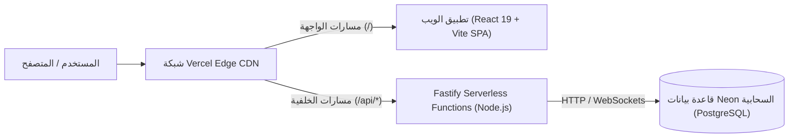

# دليل النشر والاستضافة | AN DEV Deployment Guide

يوثق هذا الدليل كافة خطوات واستراتيجية استضافة ونشر منصة **AN DEV** بالكامل على منصة **Vercel** مع ربطها بقاعدة بيانات سحابية حديثة من **Neon (PostgreSQL)**.

---

## 🏗️ 1. المعمارية السحابية (Cloud Architecture)

تم تصميم المشروع ليعمل بكفاءة وسرعة فائقة ضمن بيئة خالية من الخوادم (Serverless Architecture):



- **الواجهة الأمامية (Frontend):** مبنية بـ React 19 و Vite، تُرفع كملفات ثابتة (Static Assets) فائقة السرعة تُخدم عبر شبكة Vercel Global Edge CDN.
- **الخلفية (Backend API):** خادم Fastify محزّم مسبقاً بواسطة `esbuild` ليعمل كدوال سحابية (Vercel Serverless Functions) في `api/index.js` ونقاط الدخول المباشرة.
- **قاعدة البيانات (Database):** قاعدة بيانات PostgreSQL سحابية مستضافة على **Neon.tech** متوافقة تماماً مع Serverless Connection Pooling، وتدار محلياً وسحابياً بواسطة **Drizzle ORM**.

---

## 📋 2. المتطلبات الأساسية (Prerequisites)

قبل البدء بعملية النشر، تأكد من توفر الآتي:
1. مستودع الكود مرفوعاً على حسابك في **GitHub** (`main` branch).
2. حساب مجاني أو مدفوع على **[Vercel](https://vercel.com)**.
3. حساب مجاني على **[Neon Database](https://neon.tech)**.

---

## 🚀 3. خطوات الاستضافة خطوة بخطوة (Step-by-Step Guide)

### الخطوة الأولى: إعداد قاعدة البيانات على Neon.tech

1. سجّل الدخول إلى [Neon Console](https://console.neon.tech).
2. أنشئ مشروعاً جديداً باسم `andev-production` (اختر أقرب منطقة، مثلاً `Frankfurt - eu-central-1` أو `London - eu-west-2`).
3. بعد إنشاء المشروع، ستظهر لك لوحة تفاصيل الاتصال (Connection Details).
4. انسخ رابط الاتصال المجمّع **Pooled Connection String** (الذي يحوي كلمة `pooler` في الرابط)، وسيكون شكله كالتالي:
   ```text
   postgresql://[user]:[password]@[endpoint]-pooler.[region].aws.neon.tech/neondb?sslmode=require
   ```
5. *(اختياري)* لتغذية قاعدة البيانات بالمشاريع الأولية وحساب المدير من جهازك المحلي:
   - ضع الرابط في ملف `apps/api/.env`:
     ```env
     DATABASE_URL="postgresql://[user]:[password]@[endpoint]-pooler.[region].aws.neon.tech/neondb?sslmode=require"
     ```
   - شغّل أمر تعبئة البيانات:
     ```bash
     npm run seed
     ```

---

### الخطوة الثانية: ربط المشروع على Vercel

1. افتح لوحة تحكم [Vercel Dashboard](https://vercel.com/dashboard).
2. اضغط على **"Add New..."** ثم اختر **"Project"**.
3. حدد مستودع المشروع `AN-DEV` من قائمة مستودعات GitHub الخاصة بك واضغط **Import**.
4. في شاشة إعدادات المشروع (**Configure Project**):
   - **Project Name:** `an-dev` (أو أي اسم تفضله).
   - **Framework Preset:** اختر **Vite**.
   - **Root Directory:** اتركها `./` (المجلد الرئيسي للمشروع).
   - **Build and Output Settings:**
     - افتح القائمة المنسدلة وقم بتفعيل التخصيص (Override):
     - **Build Command:** `npm run build`
     - **Output Directory:** `dist`
     - **Install Command:** `node scripts/install.cjs`

---

### الخطوة الثالثة: ضبط المتغيرات البيئية (Environment Variables)

في نفس صفحة استيراد Vercel (أو من **Settings -> Environment Variables** بعد النشر)، أضف المتغيرات التالية:

| اسم المتغير (Variable Name) | القيمة المقترحة (Value) | الوصف |
| :--- | :--- | :--- |
| `DATABASE_URL` | رابط Neon المجمّع (`postgresql://...-pooler...`) | رابط الاتصال بقاعدة بيانات PostgreSQL السحابية |
| `COOKIE_SECRET` | سلسلة عشوائية من 32 حرفاً على الأقل (مثلاً: `andev-prod-secret-session-key-2026-safe`) | مفتاح تشفير كوكيز جلسات الدخول للمشرف |
| `NODE_ENV` | `production` | بيئة التشغيل للإنتاج |

> [!TIP]
> **إعدادات إرسال البريد (اختياري):**
> إذا كنت تريد استقبال إشعارات استمارة التواصل عبر البريد، أضف المتغيرات التالية:
> - `SMTP_HOST`: خادم البريد (مثل `smtp.gmail.com` أو خادم استضافتك).
> - `SMTP_PORT`: المنفذ (مثل `465` أو `587`).
> - `SMTP_USER`: بريدك الإلكتروني.
> - `SMTP_PASS`: كلمة مرور التطبيق (App Password).
> - `ADMIN_EMAIL`: البريد الذي ستصل إليه الطلبات (مثل `contact@andev.dz`).

---

### الخطوة الرابعة: بدء النشر (Deploy)

1. اضغط على زر **"Deploy"**.
2. سيقوم Vercel تلقائياً بتنفيذ المراحل التالية:
   - تشغيل `node scripts/install.cjs` وتثبيت اعتماديات Monorepo بأعلى سرعة وتوافق.
   - تشغيل `node scripts/build.cjs` الذي يبني واجهة React بواسطة Vite، ويحزم دوال الـ Fastify API تلقائياً عبر `esbuild` في مجلدات `api/`.
   - رفع الملفات وتوزيعها عالمياً في غضون ثوانٍ.
3. عند اكتمال البناء، ستظهر لك شاشة التهنئة مع رابط النطاق المباشر المخصص لك (مثلاً: `https://an-dev.vercel.app`).

---

## 🔒 4. فحص واختبار الموقع بعد الاستضافة

### 1. فحص سلامة الواجهة والـ API:
- افتح رابط الصحة:
  `https://[your-domain].vercel.app/api/health`
  يجب أن يرجع JSON بالصيغة:
  ```json
  { "status": "ok", "timestamp": "..." }
  ```

### 2. تسجيل دخول لوحة التحكم:
- توجه إلى رابط لوحة التحكم:
  `https://[your-domain].vercel.app/admin/login`
- سجّل الدخول ببيانات المدير الافتراضية:
  - **البريد الإلكتروني:** `ammar@andev.dz`
  - **كلمة المرور:** `admin123456`
- ستدخل مباشرة إلى لوحة القيادة، وتستطيع إدارة المشاريع، استعراض الرسائل الواردة، ونشر المقالات.

---

## 🌐 5. ربط دومين مخصص (Custom Domain مثل andev.dz)

إذا كنت تملك نطاقاً مخصصاً (Domain Name):
1. في لوحة Vercel، اذهب إلى **Settings** -> **Domains**.
2. أكتب النطاق الخاص بك (مثلاً `andev.dz` أو `www.andev.dz`) واضغط **Add**.
3. سيعطيك Vercel سجلات الـ DNS المطلوبة:
   - **سجل A:** للنطاق الأساسي (`@` يشير إلى IP خوادم Vercel `76.76.21.21`).
   - **سجل CNAME:** للنطاق الفرعي (`www` يشير إلى `cname.vercel-dns.com`).
4. توجّه إلى لوحة تحكم مزود الدومين الخاص بك وأضف السجلات السابقة.
5. سيقوم Vercel تلقائياً بتوليد شهادة أمان **SSL/TLS مجانية** وتفعيل التشفير `HTTPS` خلال دقائق.

---

## 🛠️ 6. معمارية الحل التقني لمشاكل Vercel Serverless (Engineering Details)

أثناء تجهيز المنصة للنشر على Vercel، تم تطبيق أفضل الممارسات الهندسية لحل التحديات الشائعة في الـ Serverless Monorepo:

1. **الاستغناء عن الإضافات المترجمة بلغة C++ (No C++ Native Addons):**
   - تم استبدال مكتبات التشفير المحلية المعتمدة على C++ node-gyp (مثل `argon2`) بدوال التشفير القياسية المدمجة في نواة Node.js (`crypto.scryptSync` مع المقارنة الزمنية الآمنة `crypto.timingSafeEqual`)، مما يمنع حدوث أخطاء `FUNCTION_INVOCATION_FAILED` في حاويات السيرفرلس.
2. **التحزيم المسبق عبر `esbuild` (Pre-bundling):**
   - يقوم سكربت `scripts/build.cjs` بتجميع كود TypeScript وقواعد البيانات والمسارات في ملف CommonJS أحادي ومستقل بذاته داخل `api/index.js` ونقاط الدخول الفرعية.
3. **توافق الـ Routing عبر `x-matched-path` و `Readable Stream`:**
   - خادم Fastify يعالج الطلبات سواء تم استدعاء الملف مباشرة أو تمت إعادة توجيهه عبر قواعد `vercel.json`، مع إعادة بناء الـ Stream للطلبات ذات الـ JSON Body لمنع تجمد الخادم عند استهلاك الـ Stream مسبقاً من قِبل Vercel.

---

## 🔄 7. التحديثات والتطوير المستمر (Continuous Deployment)

- المنصة مهيأة بنظام **CI/CD التلقائي**:
- في كل مرة تقوم بعمل `git push origin main`، سيبدأ Vercel بناءً وتحديثاً تلقائياً للموقع بدون أي توقف في الخدمة (Zero-Downtime Deployment).
