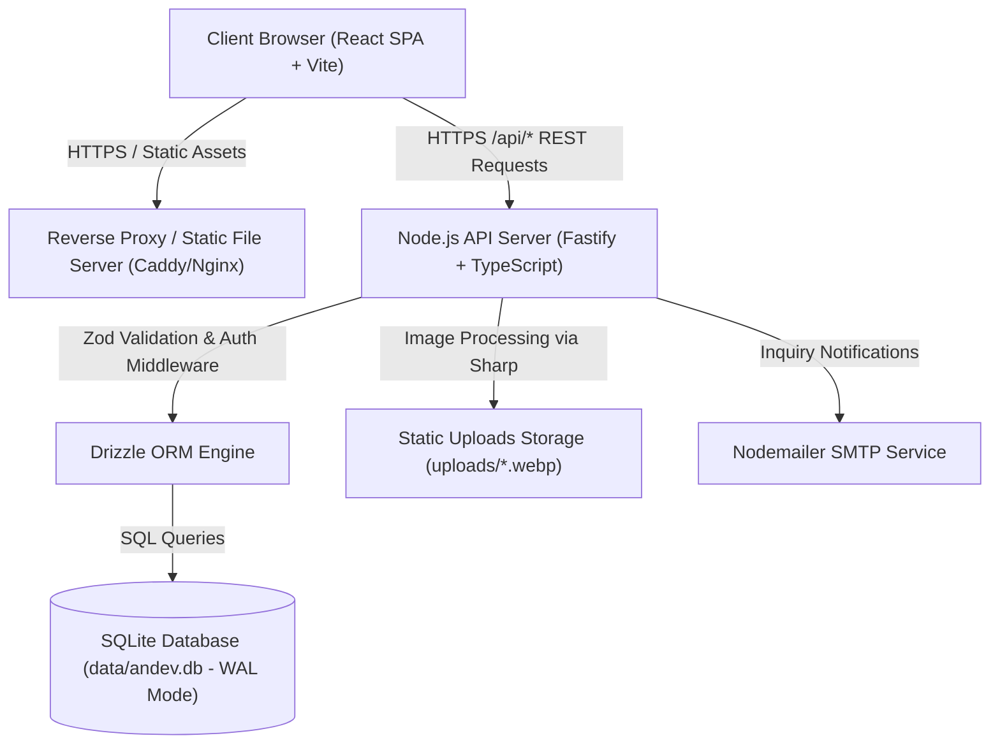

# AN DEV Website v1.0

*   **Author:** Ammar
*   **Status:** Draft
*   **Date:** 2026-11-07

--------------------------------------------------------------------------------

## Overview

AN DEV is a software development agency in Algeria building bespoke web applications, mobile apps, and backend systems. This project establishes the official bilingual digital platform (Arabic RTL default, English LTR) with a Vite + React client, Fastify + SQLite API, and an administrative control panel for managing inquiries and portfolio case studies.

## The Problem

The existing site is an unmanaged static webpage. It cannot collect structured project inquiries, track sales pipelines, update client case studies, or record aggregate visitor metrics without manual code modification and server redeployments.

## Goals

*   **Lead Acquisition**: Capture inbound project inquiries via a validated form with honeypot spam protection, SQLite persistence, and email notification, targeting >= 10 inquiries/month within 3 months.
*   **Portfolio Showcase**: Publish 6 complete project case studies at launch with bilingual summaries, technical tags, and screenshots.
*   **Autonomous Administration**: Enable administrative management of projects, inquiry tracking, and site settings via a protected web interface in < 5 minutes per update.
*   **Performance & SEO**: Reach >= 90 Lighthouse mobile score, sub-2s initial load on 4G, and structured Open Graph and sitemap metadata.

## Non-Goals

*   Payment gateway integrations, invoicing, or escrow handling.
*   Public client accounts, customer authentication, or client portals.
*   In-app real-time live chat or automated chatbot widgets.
*   Native mobile applications.

## Open Questions

*   **Question 1**: Should the contact page include direct WhatsApp and Telegram click-to-chat links alongside the form to accommodate regional conversion patterns in Algeria?
*   **Question 2**: Should the Markdown blog (P2) be included in the v1 deployment or phased immediately after the core conversion funnel (P0)?

## Critical User Journeys (CUJs)

### CUJ 1: Prospective Client Submits Project Inquiry
*   **Given**: An anonymous visitor arrives on the homepage (`/`) or contact page (`/contact`).
*   **When**: The visitor selects project type (web/mobile/system), enters contact information, describes their project, leaves the hidden honeypot field untouched, and submits.
*   **Then**: The API validates inputs via Zod, hashes the IP address for rate limiting, persists the record with status `new`, triggers an admin email notification, and displays a confirmation message with a 2-business-day response guarantee.

### CUJ 2: Administrator Reviews and Updates Inquiries
*   **Given**: Ammar navigates to `/admin/login` and enters valid credentials.
*   **When**: Ammar authenticates, opens `/admin/inquiries`, filters by status `new`, opens an inquiry, updates status to `in_progress`, and adds internal notes.
*   **Then**: The session cookie (`HttpOnly; Secure; SameSite=Lax`) authorizes the patch request, the database updates the status and note, and the inquiries table refreshes.

### CUJ 3: Prospective Client Explores Portfolio
*   **Given**: A visitor seeks proof of technical capability and navigates to `/projects`.
*   **When**: The visitor filters by category (e.g. `mobile`) and clicks a project card.
*   **Then**: The client routes to `/projects/:slug`, rendering bilingual details (Challenge, Solution, Results), tech chips, and an image gallery with zoomable screenshots.

### CUJ 4: Search Engine Crawlers & Social Platforms Index AN DEV
*   **Given**: A Google, Bing, or social media crawler (or user sharing a link on WhatsApp/LinkedIn/Twitter) requests any page on `andev.dz`.
*   **When**: The crawler requests the page or XML sitemap (`/sitemap.xml`, `/robots.txt`).
*   **Then**: The platform serves high-fidelity localized metadata, Canonical URLs, Schema.org JSON-LD structured data (Organization, ProfessionalService, WebSite), OpenGraph/Twitter Cards, and geo-targeting coordinates for Algiers, enabling rich snippets, top local search ranking, and instant social cards.

### CUJ 5: Administrator Configures SEO & Verifies Search Engine Indexing
*   **Given**: Ammar navigates to `/admin/settings` -> SEO Hub.
*   **When**: Ammar adjusts search titles, meta descriptions, Algeria-targeted keywords, verifies Google Search Console tokens, or toggles robots indexing directives.
*   **Then**: The admin panel displays real-time Desktop & Mobile SERP simulators and social share card simulators with strict character-length health checks; upon saving, updates persist to Neon Postgres and take effect immediately across all client-rendered pages and the dynamic XML sitemap.

### CUJ 6: Evaluator Interacts with Application Showcase, Live Gateway & Hardware/OS Specs
*   **Given**: A prospective client, engineer, or enterprise evaluator visits `/projects` or a specific case study `/projects/:slug` (such as `anpos`).
*   **When**: The user opens the project page.
*   **Then**: The client renders an executive Technical Specs Strip displaying Project Type badge (`Web App`, `Mobile App`, `Desktop App`, `POS System`), Release Version (`v1.2.0`), Package/Installer Size (`24.5 MB`), supported platform icons (`Android`, `iOS`, `Windows`, `macOS`, `Linux`, `Web`, `POS Terminals`), and direct download/action buttons; followed by an interactive Live Preview Gateway with viewport switcher (Desktop / Tablet / Mobile) or responsive Device Frame Mockups with Lightbox zoom inspection.

### CUJ 7: Administrator Manages App Specifications, Platforms, Live Preview, & Screenshot Gallery
*   **Given**: Ammar authenticates and opens `/admin/projects` -> Project Editor Modal.
*   **When**: Ammar selects the project type, enters release version and installer size, ticks supported target platforms, configures live preview iframe URL, and uploads application screenshots into the gallery.
*   **Then**: The data is validated through `ProjectSchema` via Zod, persisted into Neon PostgreSQL, and immediately reflected across `/projects` filters and the `/projects/:slug` case study view.

### CUJ 8: Administrator and Evaluator Experience Type-Specialized Project Attributes (Web, Mobile, Desktop, POS, ERP)
*   **Given**: Ammar creates or edits a project in `/admin/projects`, or a visitor visits a project on `/projects/:slug`.
*   **When**: Ammar selects the Project Type (`web`, `mobile`, `desktop`, `pos`, `system_erp`).
*   **Then**: The admin form dynamically swaps the technical specifications tab to display only the relevant fields:
    *   **Web**: Live sandbox URL, viewport switcher toggle, hosting environment, PWA support.
    *   **Mobile**: APK direct download, store links, minimum OS versions, offline capabilities.
    *   **Desktop**: Installer downloads, OS architectures, embedded DB engine.
    *   **POS**: Thermal printer compatibility (58mm/80mm), hardware peripherals (scanner, drawer, scale), Algerian fiscal/tax compliance.
    *   **ERP**: Enterprise modules selector (Inventory, Accounting, HR, CRM, Invoicing), deployment model, multi-branch, audit trail.
    On the public page `/projects/:slug`, the presentation renders specialized interactive components matching the domain (Live sandbox emulator for web, QR code installer for mobile, hardware peripherals strip for POS, and interactive modules matrix for ERP).


--------------------------------------------------------------------------------

## Technical Plan (Architecture)

### 1. High-Level Architecture Diagram



### 2. Monorepo Structure & Boundary Design

```text
andev/
├── apps/
│   ├── web/                    # Vite + React 19 + TypeScript frontend
│   │   ├── src/
│   │   │   ├── components/     # UI components, layout, forms
│   │   │   ├── pages/          # Home, Projects, Details, Contact, Admin
│   │   │   ├── lib/            # i18n context, API client, query client
│   │   │   └── tokens.css      # CSS variables for design system tokens
│   │   └── vite.config.ts
│   └── api/                    # Fastify backend service
│       ├── src/
│       │   ├── db/             # Drizzle schemas, migrations, seed data
│       │   ├── routes/         # Public, Auth, Inquiries, Admin routes
│       │   ├── services/       # Argon2 auth, Sharp WebP, Nodemailer
│       │   └── app.ts          # Fastify application factory
│       └── tsconfig.json
├── packages/
│   └── shared/                 # Shared Zod schemas and TypeScript interfaces
│       └── src/
│           ├── schemas/        # InquirySchema, ProjectSchema, AuthSchema
│           └── types.ts
├── data/                       # andev.db (persistent SQLite volume)
├── uploads/                    # Generated WebP images
└── package.json                # Workspaces root
```

### 3. Database Schema Design (Drizzle + SQLite)

*   `admins`: `id` (integer primary key), `email` (text unique), `password_hash` (text), `created_at` (text).
*   `sessions`: `id` (text primary key UUID), `admin_id` (foreign key -> admins.id), `expires_at` (text).
*   `projects`: `id` (integer primary key), `slug` (text unique), `title_ar` (text), `title_en` (text), `summary_ar` (text), `summary_en` (text), `body_ar` (text), `body_en` (text), `project_type` (text default 'web': 'web' | 'mobile' | 'desktop' | 'pos' | 'system'), `version` (text default 'v1.0.0'), `package_size` (text default ''), `platforms_json` (text JSON array of supported OS e.g. '["web", "android"]'), `download_url` (text nullable), `enable_live_preview` (boolean default true), `gallery_json` (text JSON array of screenshot items), `tech_json` (text JSON string array), `cover_image` (text), `live_url` (text nullable), `repo_url` (text nullable), `featured` (integer boolean), `published` (integer boolean), `sort_order` (integer), `created_at` (text), `updated_at` (text).
*   `project_images`: `id` (integer primary key), `project_id` (foreign key -> projects.id cascade), `path` (text), `alt_ar` (text), `alt_en` (text), `sort_order` (integer).
*   `inquiries`: `id` (integer primary key), `name` (text), `email` (text), `project_type` (text: 'web' | 'mobile' | 'system' | 'other'), `budget_range` (text nullable), `message` (text), `status` (text default 'new': 'new' | 'in_progress' | 'closed'), `admin_note` (text nullable), `ip_hash` (text), `created_at` (text).
*   `posts`: `id` (integer primary key), `slug` (text unique), `title_ar` (text), `title_en` (text), `body_md_ar` (text), `body_md_en` (text), `published` (integer boolean), `published_at` (text).
*   `settings`: `key` (text primary key), `value` (text).
*   `page_views`: `id` (integer primary key), `path` (text), `day` (text YYYY-MM-DD), `count` (integer default 1).

### 4. API Endpoints Catalog

*   **Public Services**:
    *   `GET /api/projects`: List published projects ordered by `sort_order`.
    *   `GET /api/projects/:slug`: Get published project details and associated images.
    *   `GET /api/posts`: List published blog articles.
    *   `GET /api/posts/:slug`: Get article Markdown content.
    *   `GET /api/settings/public`: Return agency public contact numbers, email, and social links.
    *   `POST /api/inquiries`: Submit project lead (validated by Zod, checks honeypot, rate-limited by hashed IP, triggers notification).
    *   `POST /api/views`: Increment non-identifying aggregate daily page view counter.
*   **Authentication**:
    *   `POST /api/auth/login`: Validate credentials against `admins` via Argon2, issue HttpOnly `andev_session` cookie (valid for 7 days).
    *   `POST /api/auth/logout`: Destroy active session record and clear cookie.
    *   `GET /api/auth/me`: Return authenticated admin profile.
*   **Administration (`/api/admin/*`, Requires Session PreHandler)**:
    *   `GET /api/admin/stats`: Aggregate count of new inquiries, published projects, total articles, and 30-day view totals.
    *   `GET /api/admin/inquiries`: Query inquiries with optional status filter (`new`, `in_progress`, `closed`).
    *   `PATCH /api/admin/inquiries/:id`: Update status and internal admin note.
    *   `POST /api/admin/projects`: Create project record with bilingual fields and tech tags.
    *   `PUT /api/admin/projects/:id`: Update project record.
    *   `DELETE /api/admin/projects/:id`: Remove project record and delete associated media files.
    *   `POST /api/admin/uploads`: Multipart image upload; automatically optimizes to WebP via Sharp and returns asset path.
    *   `PUT /api/admin/settings`: Update configurable agency parameters.

### 5. Design System Tokens & RTL Support

```css
:root {
  --bg: #050816;
  --surface: #0B1430;
  --line: #1A2850;
  --ink: #E6E6E6;
  --mute: #8D99B3;
  --primary: #0D6EFD;
  --accent: #00C3FF;
  --ok: #10B981;
  --warn: #F59E0B;
  --err: #EF4444;
}

[data-theme="light"] {
  --bg: #F4F7FD;
  --surface: #FFFFFF;
  --line: #C9D6F2;
  --ink: #0B1226;
  --mute: #4B5878;
  --accent: #0087B8;
}
```
*   **Bi-directional Logic**: Managed via `dir="rtl"` (Arabic) and `dir="ltr"` (English) using CSS logical properties (`margin-inline`, `padding-inline`, `border-inline-start`) to maintain symmetry across both languages without duplication.

### 6. Application Showcase, Live Preview Gateway & Technical Specifications Architecture

#### Technical Specifications & Platform Taxonomy
Every project case study encapsulates an executive specification metadata block indicating software form factor, release lifecycle, package size, and execution environments:
*   **Project Types (`project_type`)**:
    *   `web`: Web Application & Cloud SaaS (منصة ويب وسحابية)
    *   `mobile`: Mobile Application (تطبيق هواتف ذكية - Android / iOS)
    *   `desktop`: Desktop Software (برنامج حاسوب مكتبي - Windows / macOS / Linux)
    *   `pos`: POS & Embedded Terminal (نظام كاشير ونقاط بيع ومحاسبة)
    *   `system`: Enterprise Distributed System (نظام مؤسسي ولوجستي)
*   **Platform Matrix (`platforms_json`)**:
    *   `android`: Android Robot icon + OS badge
    *   `ios`: Apple icon + iOS badge
    *   `windows`: Windows icon + Windows badge
    *   `macos`: Apple icon + macOS badge
    *   `linux`: Linux/Terminal icon + Linux badge
    *   `web`: Globe/Browser icon + Web/PWA badge
    *   `pos_terminals`: Store/Terminal icon + POS Devices badge
*   **Release Specifications**:
    *   `version`: semantic version string (e.g. `v1.2.0`, `v2.0.4`)
    *   `package_size`: human-readable binary or asset size (e.g. `24.5 MB APK`, `48 MB Installer`, `120 KB gzip`)
    *   `download_url`: direct secure download URL for binary installers, APK files, or release archives.

#### Live Preview Gateway (`ProjectLiveGateway.tsx`)
Provides an interactive embedded runtime for web platforms and responsive web systems:
*   **Viewport Emulation Toolbar**: Allows prospective clients to test how the platform responds across different form factors without opening external devices:
    *   **Desktop Mode**: `100%` fluid width, 16:9 aspect ratio.
    *   **Tablet Mode**: `768px` fixed width with centered container.
    *   **Mobile Mode**: `390px` fixed width with realistic smartphone container and rounded bezel.
*   **Runtime Controls**: Full-screen toggle, iframe refresh/reload button, and fallback external tab launcher.
*   **Security & Frame Policies**: Controlled iframe sandbox attributes (`sandbox="allow-scripts allow-same-origin allow-forms allow-popups"`). An automatic CSP/X-Frame-Options fallback detection renders a graceful direct launch portal card if third-party headers prevent iframe framing.

#### Device Frame Mockup Gallery (`ProjectScreenshotGallery.tsx`)
Showcases high-resolution application screenshots within context-aware device frames:
*   **Device Shells**:
    *   **Mobile Shell**: iPhone/Android smartphone frame with speaker notch and edge bezels.
    *   **Browser Shell**: macOS/Chrome style window frame with traffic light controls and address bar.
    *   **Desktop Shell**: Workstation monitor frame for desktop software.
*   **Lightbox Zoom & Navigation**: Fullscreen modal inspection with pan-and-zoom, keyboard navigation (Escape to close, Left/Right arrows for next/prev), and caption overlay.

#### Administrative Control & Curation (`ProjectSpecsFields.tsx` & `ProjectGalleryManager.tsx`)
Empowers administrators to manage all showcase attributes directly within `ProjectEditModal`:
*   Interactive platform checkboxes and type selectors with instantaneous validation.
*   Multi-screenshot upload and URL management with drag/reorder capability and caption editing.
*   Toggle for Live Preview Gateway activation per project.


--------------------------------------------------------------------------------

## Non-Functional Requirements

### Security & Privacy
*   **Password Hashing**: Administrative credentials hashed via Argon2id with recommended parameters (`memoryCost: 65536, timeCost: 3`).
*   **Session Management**: Random UUID tokens stored in the SQLite `sessions` table and transmitted via `HttpOnly`, `SameSite=Lax`, and `Secure` cookies with 7-day expiration.
*   **Data Protection & Privacy**: Zero tracking cookies. IP addresses are hashed using SHA-256 with a daily rotating salt before storing in `inquiries.ip_hash` for abuse throttling; raw IP addresses are discarded immediately.
*   **Input Sanitization & Schema Validation**: Strict Zod validation on every public and administrative endpoint before data reaches the ORM layer.
*   **Abuse Prevention**: Honeypot form field (`honeypot`) rejecting automated bot submissions, accompanied by in-memory rate limiting (max 5 inquiry submissions per 15-minute window per IP hash).

### Performance & Latency
*   **Asset Delivery & Code Splitting**: Frontend bundle code-split by route (Home, Projects, Details, Contact, Admin) using React dynamic imports. Target initial gzipped JavaScript bundle < 80kB.
*   **Optimized Media**: All project portfolio screenshots converted to modern WebP format via Sharp, served with immutable cache headers (`Cache-Control: public, max-age=31536000, immutable`).
*   **Database Concurrency**: SQLite configured in Write-Ahead Logging (`WAL`) mode with synchronous normal (`PRAGMA synchronous = NORMAL;`) allowing non-blocking concurrent reads while background transactions commit.

### Accessibility & Internationalization
*   **WCAG 2.1 AA Compliance**: Color contrast ratio >= 4.5:1 across both Dark and Light color palettes.
*   **Keyboard & Screen Reader Navigability**: Interactive elements feature visible focus rings (`--accent`) and semantic ARIA landmarks.
*   **Native Bi-directional Layout**: Bidirectional CSS logical properties (`margin-inline`, `padding-inline`, `inset-inline-start`) driven by dynamic HTML `dir="rtl"` (Arabic) and `dir="ltr"` (English).

--------------------------------------------------------------------------------

## Detailed Implementation Plan

### Target Files to Create/Modify

#### 1. Monorepo Configuration & Shared Module
*   `package.json` (Create): Root workspaces declaration (`apps/*`, `packages/*`), build and test scripts.
*   `packages/shared/package.json` (Create): Package manifest declaring `@andev/shared` exports for browser and node runtimes.
*   `packages/shared/tsconfig.json` (Create): Strict TypeScript compiler configuration for the shared module.
*   `packages/shared/src/schemas/inquiry.ts` (Create): Zod schema for project inquiries validating name, email, project type, message length, and honeypot emptiness.
*   `packages/shared/src/schemas/project.ts` (Create): Zod validation schemas for project creation, bilingual attributes, tech tag arrays, and status toggles.
*   `packages/shared/src/schemas/auth.ts` (Create): Zod schema for administrative authentication credentials.
*   `packages/shared/src/types.ts` (Create): TypeScript type definitions derived from Zod schemas for shared frontend/backend type safety.
*   `packages/shared/src/index.ts` (Create): Public entry point exporting schemas and types.

#### 2. Backend Service (`apps/api`)
*   `apps/api/package.json` (Create): Fastify dependencies (`fastify`, `@fastify/cookie`, `@fastify/cors`, `@fastify/multipart`, `drizzle-orm`, `better-sqlite3`, `argon2`, `sharp`, `zod`).
*   `apps/api/tsconfig.json` (Create): Node.js TypeScript configuration targeting ES2022.
*   `apps/api/src/db/schema.ts` (Create): Drizzle ORM relational tables definition (`admins`, `sessions`, `projects`, `project_images`, `inquiries`, `posts`, `settings`, `page_views`).
*   `apps/api/src/db/index.ts` (Create): SQLite database connection pool initializing `better-sqlite3` and configuring `WAL` mode.
*   `apps/api/src/db/seed.ts` (Create): Initial seed data establishing default admin credentials, system settings, and 6 showcase AN DEV portfolio projects.
*   `apps/api/src/services/auth.ts` (Create): Argon2 hashing/verification and cryptographic session management.
*   `apps/api/src/services/upload.ts` (Create): Sharp pipeline converting uploaded project media into optimized WebP assets in `uploads/`.
*   `apps/api/src/services/email.ts` (Create): Nodemailer notification transport alerting administrators upon new inquiry submissions.
*   `apps/api/src/plugins/auth.ts` (Create): Fastify preHandler hook validating session cookies for protected `/api/admin/*` routes.
*   `apps/api/src/routes/auth.ts` (Create): Handlers for `/api/auth/login`, `/api/auth/logout`, and `/api/auth/me`.
*   `apps/api/src/routes/inquiries.ts` (Create): Public handler for `POST /api/inquiries` with honeypot verification and rate limiting.
*   `apps/api/src/routes/public.ts` (Create): Handlers for `GET /api/projects`, `GET /api/projects/:slug`, `GET /api/posts`, `GET /api/settings/public`, and `POST /api/views`.
*   `apps/api/src/routes/admin.ts` (Create): Administrative CRUD routes for projects, inquiries review/notes, file uploads, and settings.
*   `apps/api/src/app.ts` (Create): Fastify application factory wiring plugins, routes, and error handlers.
*   `apps/api/src/server.ts` (Create): Server entry point binding Fastify to host and port.

#### 3. Frontend Web Client (`apps/web`)
*   `apps/web/package.json` (Create): React 19, Vite, Tailwind CSS, Lucide React, and TanStack Query dependencies.
*   `apps/web/vite.config.ts` (Create): Vite configuration with React plugin and development reverse-proxy to the Fastify API.
*   `apps/web/index.html` (Create): HTML shell with Cairo & Inter web font imports and default Arabic RTL metadata.
*   `apps/web/src/tokens.css` (Create): Design token CSS variables for dark and light color systems, elevation, and borders.
*   `apps/web/src/index.css` (Create): Tailwind directives, font assignments, and global reset rules.
*   `apps/web/src/lib/i18n.tsx` (Create): Context provider managing active locale (`ar` | `en`), dictionary strings, and document `dir` switching.
*   `apps/web/src/lib/api.ts` (Create): Type-safe HTTP client wrapping Fetch for communication with `/api/*`.
*   `apps/web/src/components/layout/Navbar.tsx` (Create): Sticky header with logo, navigation links, locale toggle, and mobile menu.
*   `apps/web/src/components/layout/Footer.tsx` (Create): Footer with branding, links, contact details, and copyright.
*   `apps/web/src/components/layout/Logo.tsx` (Create): Scalable SVG logo conforming to AN DEV visual guidelines.
*   `apps/web/src/components/ui/Button.tsx` (Create): Button component supporting primary gradient, outline, and danger variants with loading spinner.
*   `apps/web/src/components/ui/TechChip.tsx` (Create): Technical pill chip with subtle border and LTR monospace typography.
*   `apps/web/src/components/ui/GlowingCodeBlock.tsx` (Create): Terminal-themed code block with blue glow shadow for Hero section.
*   `apps/web/src/components/home/Hero.tsx` (Create): Hero banner with compelling call to action and code block visual.
*   `apps/web/src/components/home/Services.tsx` (Create): Services overview rows (Web, Mobile, Custom Systems).
*   `apps/web/src/components/home/Process.tsx` (Create): 3-step structured development workflow (1 أفكار, 2 تطوير, 3 إطلاق).
*   `apps/web/src/components/projects/ProjectCard.tsx` (Create): Portfolio card with 16:10 cover image, bilingual synopsis, and tech tags.
*   `apps/web/src/components/contact/InquiryForm.tsx` (Create): Validated lead form with honeypot field, feedback alerts, and direct WhatsApp links.
*   `apps/web/src/pages/HomePage.tsx` (Create): Public landing page integrating Hero, Services, Featured Projects, Process, and CTA.
*   `apps/web/src/pages/ProjectsPage.tsx` (Create): Portfolio catalogue with category filtering and empty state handling.
*   `apps/web/src/pages/ProjectDetailPage.tsx` (Create): Deep-dive case study page with Challenge/Solution/Results breakdown and image gallery.
*   `apps/web/src/pages/ContactPage.tsx` (Create): Dedicated inquiry page with agency contact coordinates and form.
*   `apps/web/src/pages/NotFoundPage.tsx` (Create): Terminal-styled 404 page with return-to-home navigation.
*   `apps/web/src/pages/admin/AdminLoginPage.tsx` (Create): Administrative sign-in form with session establishment.
*   `apps/web/src/pages/admin/AdminLayout.tsx` (Create): Protected layout with responsive sidebar/bottom-bar navigation and authentication guard.
*   `apps/web/src/pages/admin/AdminDashboardPage.tsx` (Create): Metrics overview and recent activity stream.
*   `apps/web/src/pages/admin/AdminInquiriesPage.tsx` (Create): Inquiries triage table with status chips, details modal, and note editor.
*   `apps/web/src/pages/admin/AdminProjectsPage.tsx` (Create): Portfolio manager with drag-and-drop sort order and publish/hide toggles.
*   `apps/web/src/pages/admin/AdminProjectEditModal.tsx` (Create): Bilingual project editor with image uploader.
*   `apps/web/src/pages/admin/AdminSettingsPage.tsx` (Create): Site settings editor for contact coordinates and SEO defaults.
*   `apps/web/src/App.tsx` (Create): Application router wiring public and admin routes.

#### 4. Search Engine Optimization (SEO) & Structured Data Engine
*   `apps/web/src/components/seo/MetaTags.tsx` (Enhanced): Dynamic meta tags, OpenGraph, Twitter Cards, canonical links, hreflang alternates (`ar`, `en`, `x-default`), geo-coordinates (`DZ-16`, Algiers), and Schema.org JSON-LD structured data (`Organization`, `ProfessionalService`, `WebSite`).
*   `apps/web/src/features/admin/components/SettingsSeoSection.tsx` (Enhanced): Full-featured SEO Management panel featuring meta title/desc controls with length indicators, live Google Desktop & Mobile SERP simulators, live Social Share card simulator, Google Search Console / Bing Webmaster verification codes, and indexing control.
*   `apps/api/src/routes/public.ts` (Enhanced): Dynamic `/sitemap.xml` XML sitemap and `/robots.txt` generation referencing all published portfolio projects, blog posts, and core agency routes.

#### 5. Application Showcase, Live Preview Gateway & Technical Specifications Engine
*   `packages/shared/src/schemas/project.ts` (Modify): Extend `ProjectSchema` with `project_type`, `version`, `package_size`, `platforms_json`, `download_url`, `enable_live_preview`, and `gallery_json`.
*   `apps/api/src/db/schema.ts` (Modify): Update `projects` table with new columns and default values.
*   `apps/api/src/db/index.ts` (Modify): Include `ALTER TABLE projects ADD COLUMN IF NOT EXISTS ...` migration statements for Postgres.
*   `apps/api/src/routes/admin.ts` (Modify): Ensure `POST` and `PUT` handle the extended showcase attributes and gallery serialization.
*   `apps/web/src/features/portfolio/components/ProjectSpecsStrip.tsx` (Create): Executive specs bar showing app type badge, version tag, package size, platform icons row, and direct download launcher.
*   `apps/web/src/features/portfolio/components/ProjectLiveGateway.tsx` (Create): Interactive live preview iframe with responsive viewport emulator (Desktop 100%, Tablet 768px, Mobile 390px), reload, fullscreen, and CSP fallback card.
*   `apps/web/src/features/portfolio/components/ProjectScreenshotGallery.tsx` (Create): Context-aware device frame mockups (Mobile shell, Browser shell, Desktop shell) with interactive Lightbox zoom modal.
*   `apps/web/src/features/portfolio/pages/ProjectDetailPage.tsx` (Modify): Wire `ProjectSpecsStrip`, `ProjectLiveGateway`, and `ProjectScreenshotGallery` into the case study presentation.
*   `apps/web/src/features/portfolio/pages/ProjectsPage.tsx` (Modify): Upgrade filter pills to use deterministic `project_type` and render platform badges on `ProjectCard`.
*   `apps/web/src/features/portfolio/components/ProjectCard.tsx` (Modify): Render platform icon indicators, version tag, and app type badge.
*   `apps/web/src/features/admin/components/ProjectSpecsFields.tsx` (Create): Admin editor component for project type, version, package size, platform checkboxes, and download link.
*   `apps/web/src/features/admin/components/ProjectGalleryManager.tsx` (Create): Admin editor component for uploading and managing multi-screenshot gallery with device frame selectors.
*   `apps/web/src/features/admin/components/ProjectEditModal.tsx` (Modify): Integrate specifications and gallery management tabs into the administrative workflow.

#### 6. Interactive Inquiries, Technical Consultations & Client-Admin Lifecycle Engine
*   `packages/shared/src/schemas/inquiry.ts` (Enhanced): Full Zod schemas for dual streams (`project` vs `consultation`), consultation domains, meeting modes, tracking codes, lifecycle actions (`ApproveProjectSchema`, `ScheduleConsultationSchema`, `RejectInquirySchema`, `ClientCancelSchema`, `ClientMessageSchema`).
*   `apps/api/src/db/schema.ts` (Enhanced): Postgres table `inquiries` extended with `tracking_code`, `request_type`, `phone`, `company`, `consultation_domain`, `preferred_date`, `preferred_time_slot`, `meeting_mode`, `meeting_link`, `confirmed_datetime`, `quote_amount`, `estimated_timeline`, `cancellation_reason`, and `activity_log_json`.
*   `apps/api/src/routes/inquiries.ts` (Enhanced): Public endpoints `POST /inquiries` (generates human-readable tracking code `AND-YYYY-XXXX`), `GET /inquiries/track/:trackingCode`, `POST /inquiries/track/:trackingCode/cancel`, and `POST /inquiries/track/:trackingCode/message`.
*   `apps/api/src/routes/admin.ts` (Enhanced): Admin endpoints for filtering, searching, approving projects with quotes, scheduling consultations with Google Meet links, rejecting with reasons, and permanent hard deletion (`DELETE /inquiries/:id`).
*   `apps/web/src/features/inquiries/components/InquiryForm.tsx` (Enhanced): Dual stream selector, phone with WhatsApp support, company, consultation domain/time picker, and interactive success card with one-click copy and tracking link.
*   `apps/web/src/pages/InquiryTrackingPage.tsx` (Create): Public real-time client tracking portal with visual progress stepper, approved quotation box, Google Meet join link, request cancellation with reason, and follow-up messaging.
*   `apps/web/src/features/admin/pages/AdminInquiriesPage.tsx` (Enhanced): Advanced CRM management with aggregate KPI cards, multi-stream filtering, instant search, quick actions, and hard deletion confirmation.

--------------------------------------------------------------------------------

## Verification Plan

### Automated Test Suite
*   **Shared Validation Tests**:
    *   `packages/shared/src/schemas/inquiry.test.ts`: Verify valid submissions pass; assert that non-empty honeypot fields fail validation.
    *   `packages/shared/src/schemas/project.test.ts`: Verify bilingual fields and required technical array attributes.
*   **API Integration Tests**:
    *   `apps/api/src/routes/auth.test.ts`: Verify login with valid credentials issues cookie; verify invalid credentials return 401.
    *   `apps/api/src/routes/inquiries.test.ts`: Verify inquiry persistence in SQLite and honeypot rejection.
    *   `apps/api/src/routes/admin.test.ts`: Verify unauthenticated access returns 401; verify status updates and admin notes.
*   **Frontend Component Tests**:
    *   `apps/web/src/components/ui/Button.test.tsx`: Verify variant styling and disabled spinner state.
    *   `apps/web/src/components/contact/InquiryForm.test.tsx`: Verify client-side field validation and error messaging.

### End-to-End & Build Verification
*   **Full Build Command**: Execute `npm run build` at repository root to ensure zero TypeScript compile errors across `@andev/shared`, `apps/api`, and `apps/web`.
*   **End-to-End Workflow (`tests/e2e/workflow.test.ts`)**: Programmatically submit inquiry from public client -> verify SQLite persistence -> login to admin -> update inquiry status -> create new project -> verify appearance on public `/api/projects`.

--------------------------------------------------------------------------------

*Drafted with EGM*
